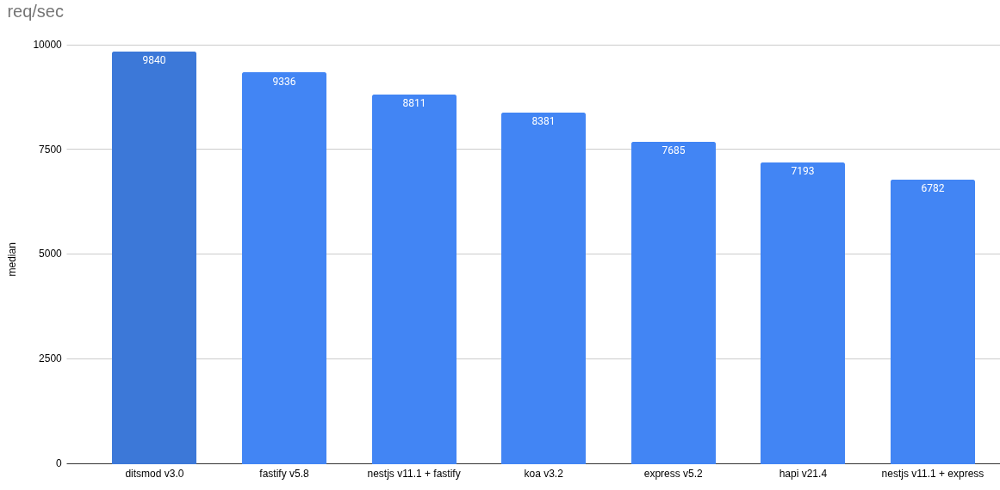

## Install and build

```bash
git clone --depth 1 https://github.com/ditsmod/vs-webframework.git
cd vs-webframework
npm i
npm run build
```

All applications are built in ESM format and `keepAliveTimeout: 0` is set.

## Cold start

The shorter the cold-start time, the better the frameworks are suited for serverless technology. So, the results of a cold start are as follows:

| framework            | result, ms    |
|----------------------|:-------------:|
| koa v2.15            |  4            |
| express v4.19        |  5            |
| hapi v21.3           |  22           |
| ditsmod v3.0         |  30           |
| fastify v4.26        |  67           |
| nest v10.3 + fastify |  89           |
| nest v10.3 + express |  108          |

For now, this benchmark is run manually, for example:

```bash
node dist/ditsmod/main.mjs
# OR
node koa.mjs
# OR
node dist/nestjs/main-express.mjs
# ...
```

See `package.json` for more examples with start script.

## Run benchmarks

From first terminal:

```bash
npm run ditsmod
```

"Hello, World!" performance comparison for web frameworks:

- `ditsmod`
- `fastify`
- `koa`
- `express`
- `nestjs-express`
- `nestjs-fastify`
- `hapi`

From second terminal:

```bash
wrk -t1 -c10 -d5 -H 'Connection: close' http://localhost:3000/hello
```




You can also check the work of Ditsmod and NestJS with controllers that are created "per request". To do this, request for the path `/hello2`, for example:

```bash
wrk -t1 -c10 -d3 -H 'Connection: close' http://localhost:3000/hello2
```
